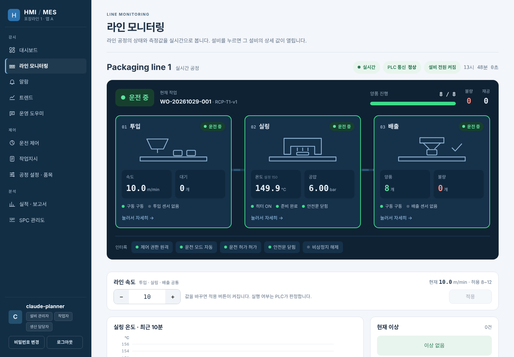
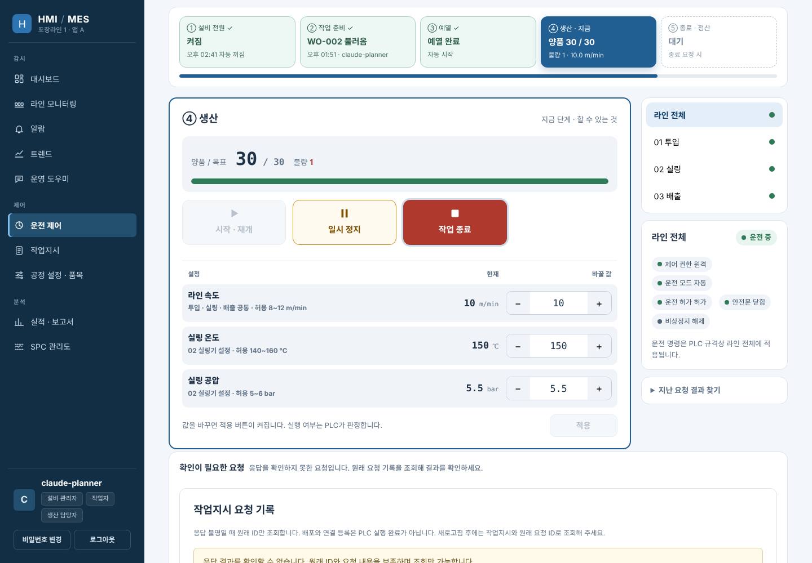
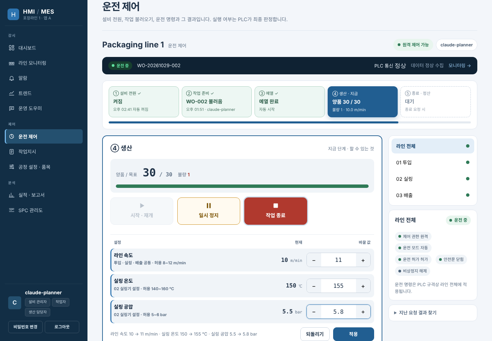
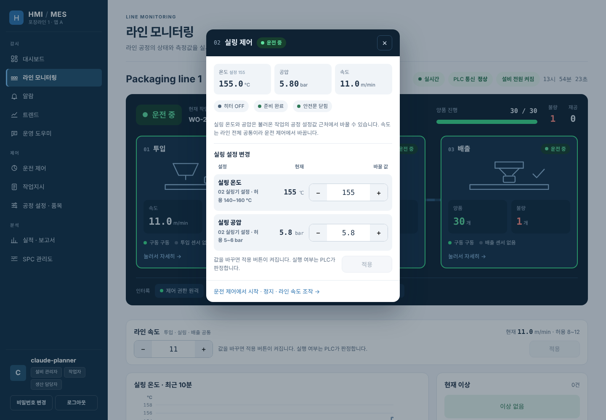
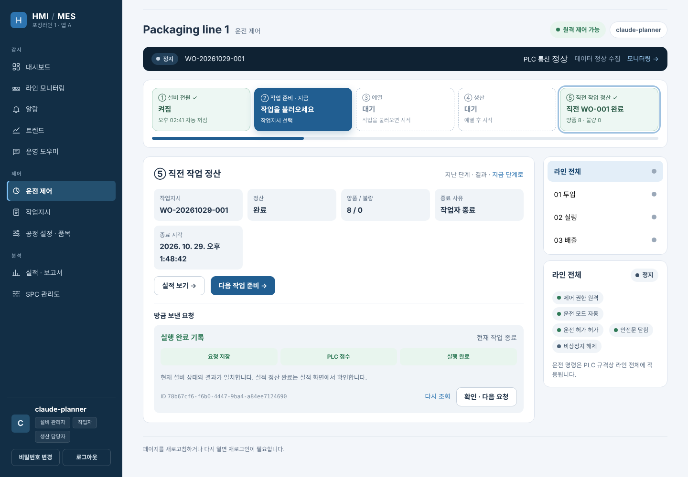
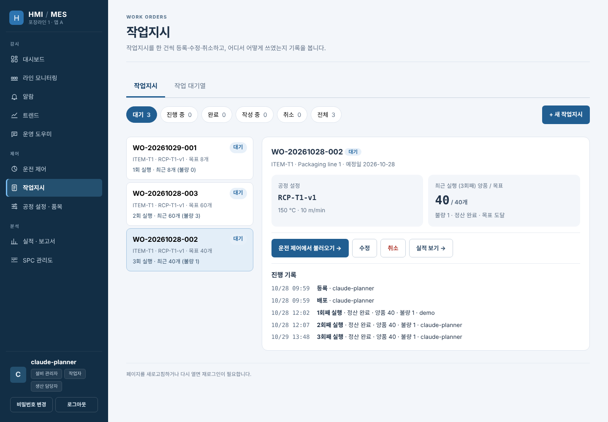
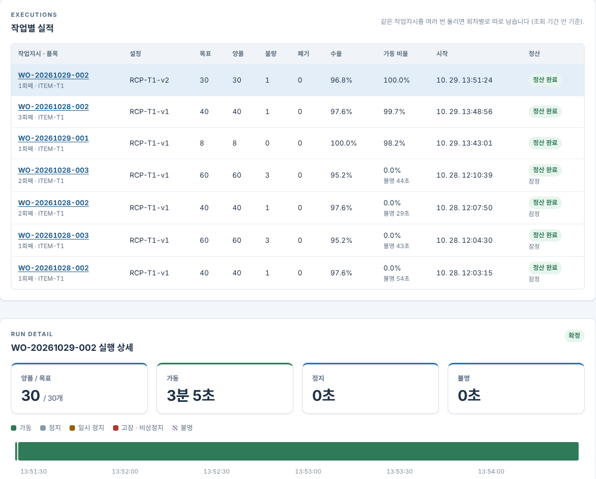
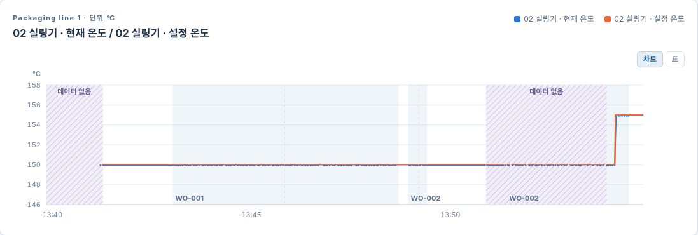
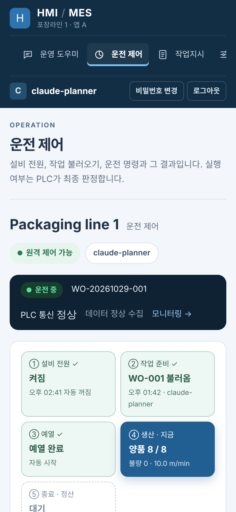

# HMI · MES — 설비 운영 시스템

가상 포장라인을 실제 암호화 OPC UA로 연결해, 설비 감시·제어부터 작업지시·실적 정산까지 잇는 웹 HMI·MES입니다.

**[포트폴리오 PDF 다운로드](hmi-mes-portfolio.pdf)** · [공개 데모](https://hmi-mes.vercel.app)

작성자 전우석 · 개발 기간 9일(2026.10.20 ~ 10.28) · 1인 프로젝트 (기획·운영 규칙 결정·검증 주도, AI 도구로 구현)

## 핵심 규칙

1. **판정은 PLC가 한다** — 화면은 요청만 보냅니다. 응답이 끊기면 같은 명령 ID로 결과만 조회하고, 새 ID로 다시 실행하지 않습니다.
2. **모르는 것은 모른다고 표시한다** — 통신 단절·품질 불명·누락을 0이나 정상값, 정산 완료로 바꾸지 않습니다.
3. **정산이 끝나야 다음 작업이다** — 생산 사건은 고유 ID로 한 번만 반영하고, 설비 최종 수량과 대조한 뒤에만 다음 작업을 연결합니다.

## 규모

DB 테이블 62개(트리거로 수정·삭제를 막는 테이블 21개) · DB 함수 25개 · 마이그레이션 28개 · 메뉴 화면 10종 · 자동화 시험 Python 2,354건 + 화면 91건

수치는 로컬 PostgreSQL에 마이그레이션을 적용해 센 값과, 2026-10-23 전체 로컬 검사 기록입니다.

## 기술 스택

Python · FastAPI · Pydantic · SQLAlchemy · PostgreSQL · Alembic · OPC UA(asyncua) · SQLite · React 19 · TypeScript · Vite · pytest · Playwright · Vercel + Neon

## 문서

| 문서 | 내용 |
| --- | --- |
| [시스템 구조](docs/system-architecture.md) | 두 앱과 게이트웨이의 배치, 명령 하나·수집 하나가 처리되는 순서, 역할 |
| [핵심 설계 결정](docs/design-decisions.md) | 결정별 문제 → 선택 → 대안 → 대가 |
| [데이터 모델](docs/data-model.md) | 테이블 네 묶음, 불변식, 트리거로 지키는 이력 |
| [명령·수집 계약](docs/protocol.md) | 명령 상태, 결과 불명, 사건 스트림, ACK와 처리 커서 |
| [핵심 코드 해설](docs/ingest-explainer.md) | 수집 트랜잭션의 잠금 순서와 사건 단위 중복 제거 |
| [테스트](docs/testing.md) | 층별 시험, 결과, 장시간·성능 기록, 하지 않은 것 |
| [사용 안내](docs/user-guide.md) | 화면별 사용 방법과 생산 한 번 해 보기 |

## 주요 화면

| 운전 제어 | 운전 중 설정 변경 |
| --- | --- |
|  |  |
| **설비 상세 창** | **정산 결과** |
|  |  |
| **같은 작업지시 3회 실행 기록** | **실행별 보고서** |
|  |  |
| **온도 트렌드** | **휴대폰 화면** |
|  |  |

화면은 2026-10-29 공개 배포를 실제로 운전하며 촬영했습니다. 설비와 PLC는 소프트웨어 시뮬레이터입니다.
