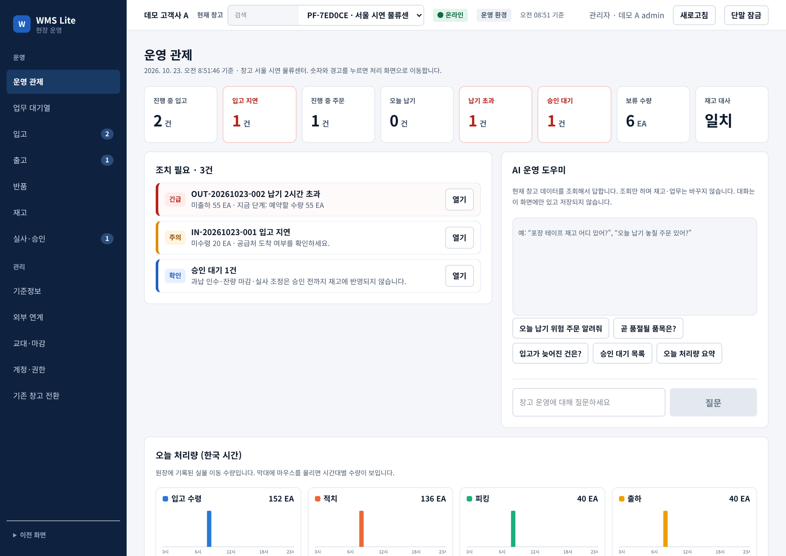
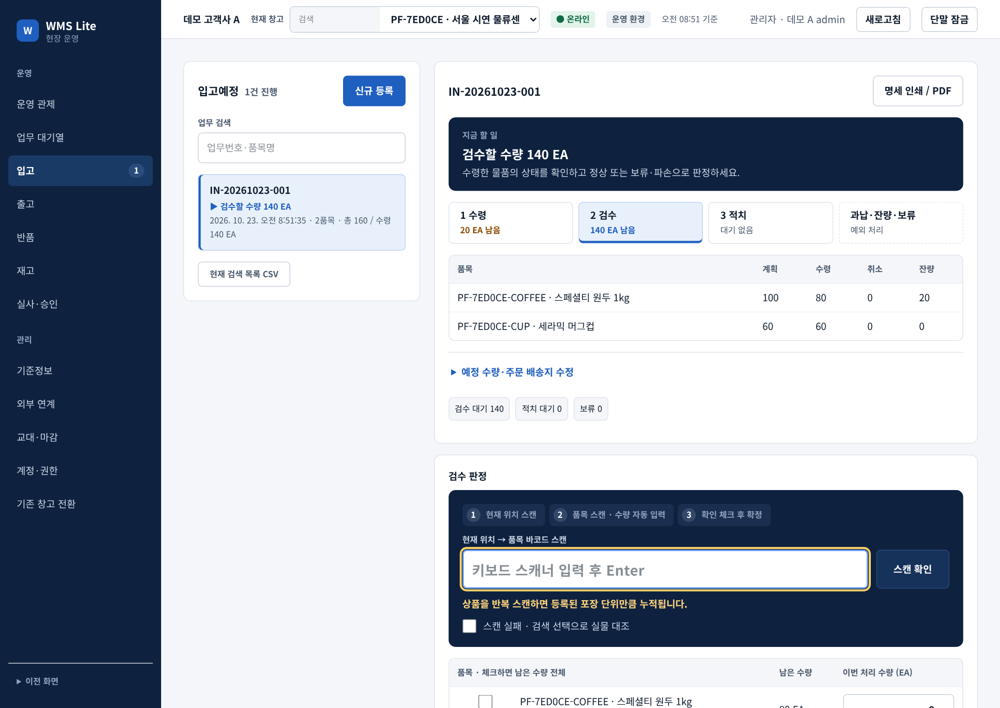
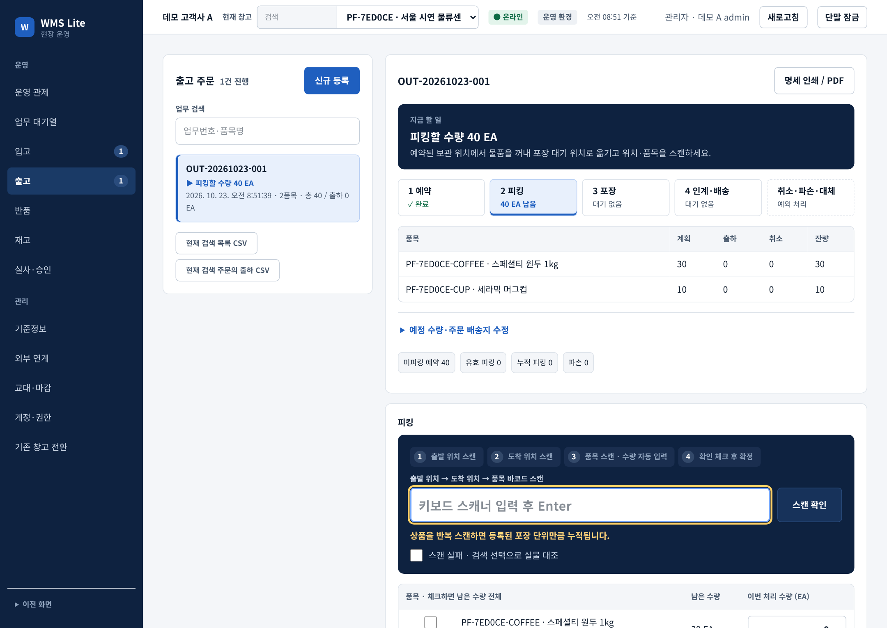
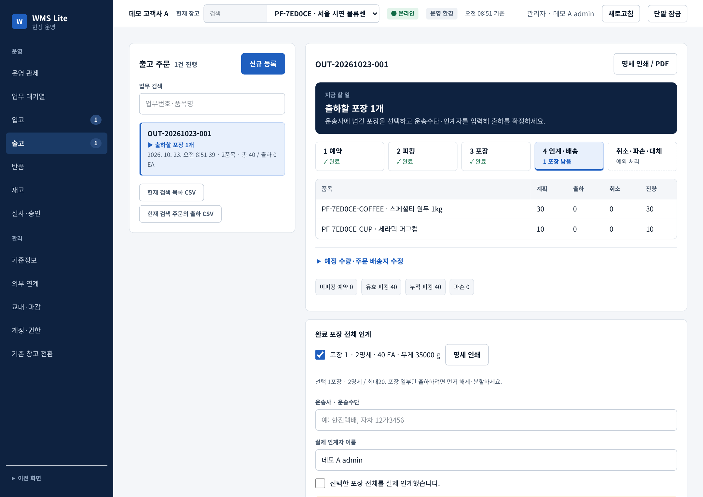
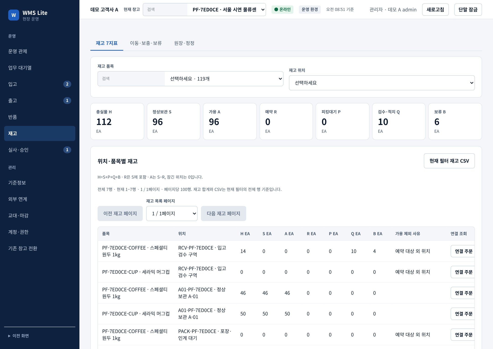
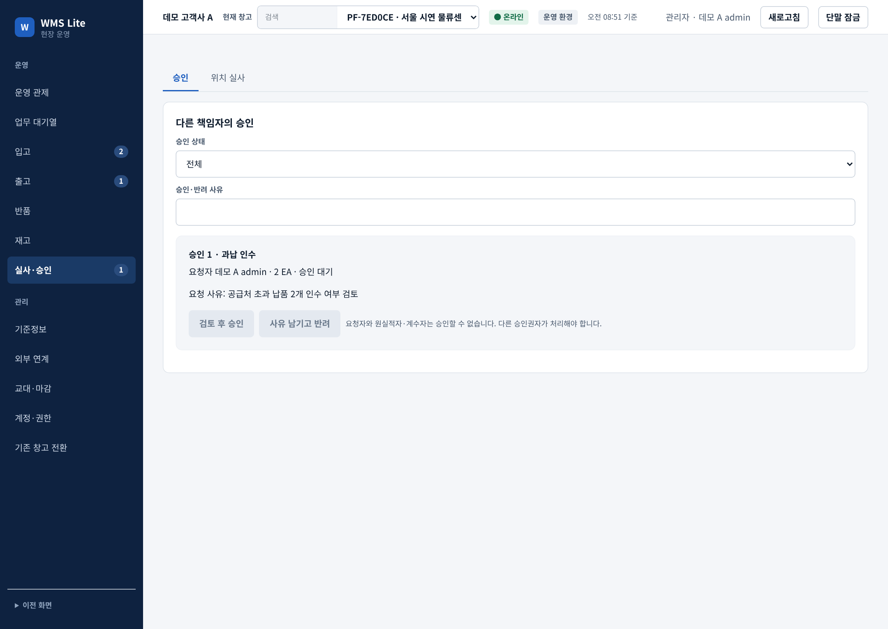
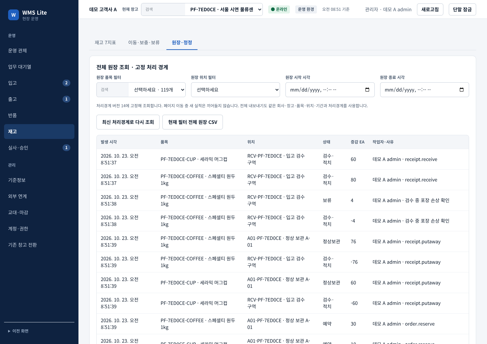

# WMS Lite — 고객사별 창고 운영관리 SaaS

입고부터 출하·반품까지, 실물·잔량·담당자를 서버 규칙과 지울 수 없는 원장으로 연결한 웹 창고 운영 시스템입니다.

**[포트폴리오 PDF 다운로드](wms-lite-portfolio.pdf)** · [공개 데모](https://wms-saa-s-platform.vercel.app/dashboard/v2)

작성자 전우석 · 개발 기간 2일 · 1인 프로젝트 (기획·규칙 결정·검증 주도, AI 도구로 구현)

## 핵심 규칙

1. **재고는 덮어쓰지 않는다** — 모든 증감은 변경·삭제가 막힌 원장에 쌓고, 현재고가 원장 합계와 같을 때만 다음 명령을 실행합니다.
2. **같은 요청은 한 번만 반영한다** — 화면이 만든 request_id로, 응답이 끊긴 재시도도 같은 결과를 돌려받습니다.
3. **권한 경계와 승인 분리** — 회사·창고·역할을 서버와 DB(RLS)가 이중으로 검사하고, 과납·실사 차이·정정은 요청자와 다른 사람이 승인합니다.

## 규모

DB 테이블 41개 · 업무 명령 40종 · API 51개 · 화면 19종 · 자동화 테스트 696건

## 기술 스택

Next.js 16 · React 19 · TypeScript · PostgreSQL(RLS) · Better Auth · Vercel + Neon · Vitest · Playwright · Claude API

## 문서

| 문서 | 내용 |
| --- | --- |
| [시스템 구조](docs/system-architecture.md) | 전체 구조, 버튼 하나가 처리되는 순서, 폴더 지도, 역할 |
| [핵심 설계 결정](docs/design-decisions.md) | 멀티테넌시·불변 원장·멱등·동시성·승인 분리 등 결정별 문제 → 선택 → 대안 → 대가 |
| [데이터 모델](docs/data-model.md) | 테이블 네 묶음, 불변식, RLS 설정 |
| [API](docs/api.md) | 주요 API, 업무 명령, 멱등과 오류 코드 |
| [테스트](docs/testing.md) | 층별 테스트, 실패 주입 시험, 측정한 개선, 하지 않은 것 |
| [운영 관제와 AI](docs/control-tower-ai.md) | 원장 집계, 품절 예측 계산, 읽기 전용 AI 도우미 구조 |
| [사용자 매뉴얼](docs/user-guide.md) | 화면별 사용 방법 |

## 주요 화면

| 입고 검수 | 출고 피킹 |
| --- | --- |
|  |  |
| **출하 인계** | **재고 7지표** |
|  |  |
| **본인 요청 승인 차단** | **원장 추적** |
|  |  |

화면은 로컬 앱·실제 PostgreSQL·합성 데이터로 촬영했습니다.
